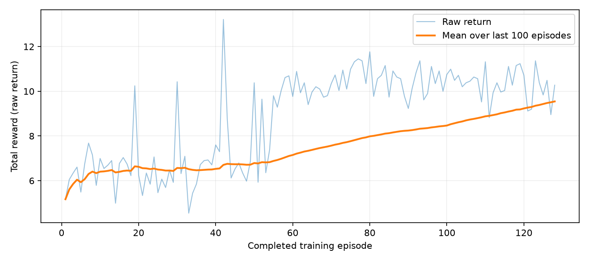

# CarRacingObstacles-v3

[](https://colab.research.google.com/github/luisgarrote/CarRacingWObstacles/blob/main/examples/quickstart.ipynb)

A Gymnasium CarRacing environment with static obstacles, moving obstacles,
mountains/trees, and an optional **visual-only ghost car**. The learner controls
one car. Observations are 96 x 96 RGB images (`uint8`).

## Install

Use Python 3.10+ in an activated virtual environment. Python 3.11 and 3.12 are
included in CI. Box2D needs a C++ compiler if a compatible wheel is unavailable.
Install SWIG before building its bindings:

```sh
git clone https://github.com/luisgarrote/CarRacingWObstacles.git
cd CarRacingWObstacles
python -m venv .venv
# macOS/Linux:
source .venv/bin/activate
# Windows PowerShell: .venv\Scripts\Activate.ps1
python -m pip install --upgrade pip setuptools wheel swig
python -m pip install --no-build-isolation -r requirements.txt
python -m pip install -e ".[sb3]"
```

Omit `[sb3]` for the environment alone. `pygame-ce` provides the `pygame` import;
avoid installing it alongside the separate `pygame` distribution.

## Use

Import the module once to register the environment in the current Python process.
Registration is idempotent, so repeated imports/calls in notebooks are safe.

```python
import gymnasium as gym
import car_racing_obstacles

env = gym.make(
    "CarRacingObstacles-v3",
    render_mode="rgb_array",  # use "human" for an interactive window
    continuous=True,
    n_static_obstacles=5,
    n_dynamic_obstacles=5,
    n_mountains=0,
    use_ghost=True,
)
obs, info = env.reset(seed=123)
for _ in range(1000):
    obs, reward, terminated, truncated, info = env.step(env.action_space.sample())
    if terminated or truncated:
        break
env.close()
```

Continuous actions are `[steering, gas, brake]`, bounded by `[-1, 1]`, `[0, 1]`
and `[0, 1]`. Set `continuous=False` for the five discrete actions (no-op, left,
right, gas, brake). DQN requires discrete mode. PPO and A2C can use either mode;
DDPG and TD3 require continuous mode.

For Stable-Baselines3, use `CnnPolicy`; stack recent image frames when temporal
information is needed. SB3 handles image intensity normalization. Import
`car_racing_obstacles` in each process that constructs an environment, including
Zoo workers. The installed wheel includes the modules, so importing does not
require running from this source directory.

## Student workflow with Stable-Baselines3

The **Colab demo notebook** installs its dependencies and trains PPO for **500
completed training episodes**. It displays raw total reward per episode and the
mean of the last 100 episodes, selects `best_model.zip` using five separate
validation seeds every 25 episodes, and embeds a video of that checkpoint.
Validation episodes are additional to the 500 training episodes. Final testing
uses the ten supplied cases only after model selection. The notebook includes
an optional download of models, logs, graph, test statistics and MP4.


The examples use SB3 directly: `PPO(...).learn(...)`, `model.save(...)` and
`PPO.load(...)`. Start with [examples/quickstart.ipynb](examples/quickstart.ipynb)
or the short [training script](examples/train_ppo.py). Run these commands from
the cloned repository after installing `.[sb3]`.

```sh
# 1. Train and save a model, configuration, episode log and reward graph.
python examples/train_ppo.py --steps 100000 --seed 0 --output outputs/ppo_seed0
# 2. Recreate the graph from the saved episode log at any time.
python examples/plot_rewards.py --log outputs/ppo_seed0/training.monitor.csv --output outputs/ppo_seed0/rewards.png
# 3. Load the saved model and run one fixed scenario.
python examples/run_model.py --run outputs/ppo_seed0 --case normal_1
# 4. Evaluate all ten fixed cases and retain every result, including failures.
python examples/evaluate.py --run outputs/ppo_seed0
# 5. Record one complete episode as MP4.
python examples/record_video.py --run outputs/ppo_seed0 --case normal_1 --output outputs/ppo_seed0/demo.mp4
```

The budget above is an example, not a promise of a successful policy. Each training
run needs a new output directory. Change `--seed` and `--output` for independent
training runs; report results across training seeds. The examples use one
`DummyVecEnv` environment and CPU execution to keep the code readable.

### Episode returns: raw and last 100 episodes

`Monitor` saves the **sum of rewards per completed episode**, before any reward
normalization, in `training.monitor.csv`. [plot_rewards.py](examples/plot_rewards.py)
uses Python's `csv` module, NumPy and Matplotlib; no pandas or dashboard is needed.
The essential calculation is:

```python
# rewards[i] is the total reward of episode i, in chronological order.
average = np.array([
    rewards[max(0, i - 99):i + 1].mean() for i in range(len(rewards))
])
plt.plot(rewards, alpha=0.45, label="Raw episode return")
plt.plot(average, label="Mean of last 100 episodes")
plt.xlabel("Completed episode")
plt.ylabel("Total reward")
plt.legend()
```

Before 100 episodes exist, the mean uses all available completed episodes.
`rewards.png` contains both curves; `rewards.csv` contains their numerical values (see the [example data](docs/example_rewards.csv)).
An unfinished final episode is not included. Training logs are separate from the
held-out evaluation results.



This example graph comes from a **2,048-transition integration check with a
16-step episode cap**, not a trained benchmark result. Use the normal episode
horizon for your experiments.

### Saved model, evaluation statistics and video

Keep `model.zip` and `config.json` together. The run/evaluation/video scripts
restore the same observation history. SB3 chooses deterministic actions for these
scripts. Training uses raw rewards and does not apply `VecNormalize`.

`evaluate.py` writes `evaluation.csv` and `evaluation.json` inside the run folder:
all ten episode returns, lengths, success and termination/truncation flags, plus
**mean return, population standard deviation and success rate for each group**.
Task-specific columns include contact steps and, for the forklift, pickup events,
delivery events and pallets delivered. CarRacing contact steps count the reported
static-obstacle collision flag only. Failed episodes are retained.

[record_video.py](examples/record_video.py) captures the initial frame and every
simulation step, including the final frame, without action/frame skipping. Frames
are streamed to MP4, with the longer side limited to 640 pixels. The accompanying
JSON records the case, return, success and frame rate. Video uses simulation time;
it does not affect policy observations. Video encoding dependencies are included
in `.[sb3]`.

`--max-steps 16` is available for quick integration checks in all scripts; it
changes the task horizon. Shortened evaluation files are named
`evaluation_short_16.*` and must not be reported as benchmark scores.

### CarRacing training settings and fixed evaluation scenarios

The demo uses continuous controls, `CnnPolicy` and four recent RGB frames
(`--history 4`, giving 12 channels). SB3 scales uint8 pixel intensities internally.
Training samples tracks on reset. Add `--randomize` to vary appearance during
training; `--obstacles N` and `--traffic N` enable extra hazards. The assignment's
standard evaluation suite has no added obstacles, mountains or ghost.

To train for **500 completed episodes** with four-frame history and an action
held for three physics frames:

```sh
python examples/train_ppo.py --episodes 500 --history 4 --action-repeat 3 --seed 0 --output outputs/ppo_h4_repeat3_seed0
```

For DQN with the same history, persistence and episode target, use the native
five-action discrete control mode:

```sh
python examples/train_dqn.py --episodes 500 --history 4 --action-repeat 3 --seed 0 --output outputs/dqn_h4_repeat3_seed0
```

The DQN demo uses a 10,000-transition replay buffer, 1,000 warm-up decisions,
one update every four decisions and epsilon-greedy exploration. The replay
buffer stores both image stacks and next stacks (roughly 2.2 GB at this size).
The same run/evaluation/video scripts read the algorithm and action mode from
`config.json` and work with either saved PPO or DQN models.

`--episodes` replaces the timestep stopping budget. The SB3 callback stops when
the episode count is reached. SB3 timesteps count **policy decisions**: one PPO
iteration collects `--rollout` decisions (512 by default) before updating. With
persistence 3, each decision advances up to three physics frames, sums their
rewards and returns the final image. It stops early at episode boundaries. The
four-image stack contains recent **decision-time images** (12 RGB channels),
with no max pooling. The 1,000-step time limit still counts physics frames.

`training.monitor.csv` records episode return, decision count, physics-frame
count and success. `progress.json` reports the live completed-episode count,
last-100 mean return, successes and frame counts. The graph refreshes every 25
episodes; checkpoints are saved every 50. The final, potentially incomplete PPO
rollout is discarded when the episode callback stops collection, as in SB3's
standard episode-stop callback. Run, evaluation and video scripts restore the
saved persistence value automatically. Video still captures every physics frame
at 50 fps, including intermediate frames while an action is held.

[evaluation_cases.json](examples/evaluation_cases.json) freezes the seeds and all
environment settings for five standard tracks and five appearance-randomized
cases. The latter are **not paired copies of the standard track geometry**:
appearance and track generation both consume random numbers.

| Group | Case IDs | Reset seeds | Appearance randomization | Step cap |
|---|---|---|---|---:|
| Standard | `normal_1`–`normal_5` | 20001–20005 | Off | 1000 |
| Randomized | `randomized_1`–`randomized_5` | 21001–21005 | On | 1000 |

```sh
python examples/train_ppo.py --randomize --steps 300000 --seed 0 --output outputs/random_seed0
python examples/run_model.py --run outputs/random_seed0 --case randomized_1
python examples/record_video.py --run outputs/random_seed0 --case randomized_1 --output outputs/random_seed0/randomized.mp4
```

Success is the environment's successful lap flag. Reuse the same ten held-out
cases for every method and retain failures. Do not train or choose hyperparameters
on these seeds; use separate validation seeds. Record the code revision, package
versions and manifest with your results; seeded track generation is tied to the
implementation. The provided demo uses PPO. For DQN, select discrete actions and
use its corresponding model class when training/loading; DDPG and TD3 require
continuous actions. A2C supports either action type.

## Task semantics and reproducibility

- Only the learner's wheels earn new-tile rewards. The ghost is visible but
  cannot collide, change the learner's trajectory, or collect rewards.
- This is a **single-lap task**: visiting all tiles, or crossing the start tile
  after leaving it and meeting `lap_complete_percent` (default 0.95), ends the
  task. Tile visit flags are not cleared during an episode.
- A static-obstacle collision, prolonged stopping/off-road driving, or leaving
  the playfield ends the episode. Successful lap handling never cancels a failure.
- The default 1000-action horizon is a **truncation**. `CarRacingObstacles`
  accepts `max_episode_steps` directly; `gym.make(..., max_episode_steps=...)`
  also supports Gymnasium's external TimeLimit wrapper.
- `info` includes `lap_finished`, `is_success`, and cause-specific flags such as
  `collision_static`, `stuck`, `offroad_too_long`, and `out_of_bounds` when set.
  `collision_static` is not a metric for every type of physical contact.
- `reset(seed=...)` seeds the environment RNG; subsequent unseeded resets
  continue that RNG, independently of Python's process-global random state.
- RGB observations reflect all object creation/movement for that reset or step.
- `domain_randomize=True` changes appearance at reset. Both appearance and
  track generation draw from the environment RNG. A fixed-appearance run can
  still generate different tracks.

### Version 0.2.x migration

Version 0.2.1 fixes mountain body coordinates: the polygon is now local to its
body, whose position is the actual mountain centre. The rendered mountain and
its radial hazard check therefore agree. Re-evaluate mountain-enabled scenarios
after updating; the earlier check incorrectly tested a region around the world
origin. Set `n_mountains=5` to request mountains and trees; their actual placed
counts depend on track clearance. Road blocks use the separate
`n_static_obstacles` parameter.

This release fixes empty wheels, automatic registration, false lap events,
repeated tile rewards, ghost reward attribution/collisions, cancelled failure
terminations, moving-obstacle NumPy/Box2D conversion errors, time-limit flags,
reset RNG handling and stale RGB observations. Ghost wheel transforms and motion
rate now follow the declared heading and simulation timestep. Pickling preserves
obstacle and horizon settings.

**Retrain policies and regenerate benchmark results** after updating. Returns and
lap counts from the earlier task implementation are not directly comparable.
The obsolete APA2025 exercise notebook has been removed. Use the Colab-ready
SB3 notebook in `examples/quickstart.ipynb`.

## Checks

```sh
python -m unittest discover -s tests -v
python -m pip wheel . --no-deps --no-build-isolation -w dist
python -m pip install --no-deps --force-reinstall dist/*.whl
# From a DIFFERENT directory, test that the installed wheel works:
python -c "import car_racing_obstacles, gymnasium as gym; e=gym.make('CarRacingObstacles-v3', render_mode='rgb_array'); e.reset(seed=123); e.close()"
```

CI runs the environment regressions and wheel installation check on Linux and
macOS. The `demo.py` script provides keyboard controls. See the source constructor
for obstacle, appearance and ghost settings.

## License

MIT License.
